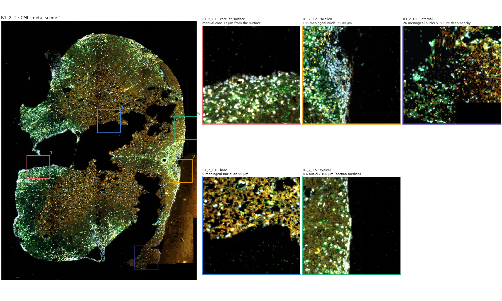
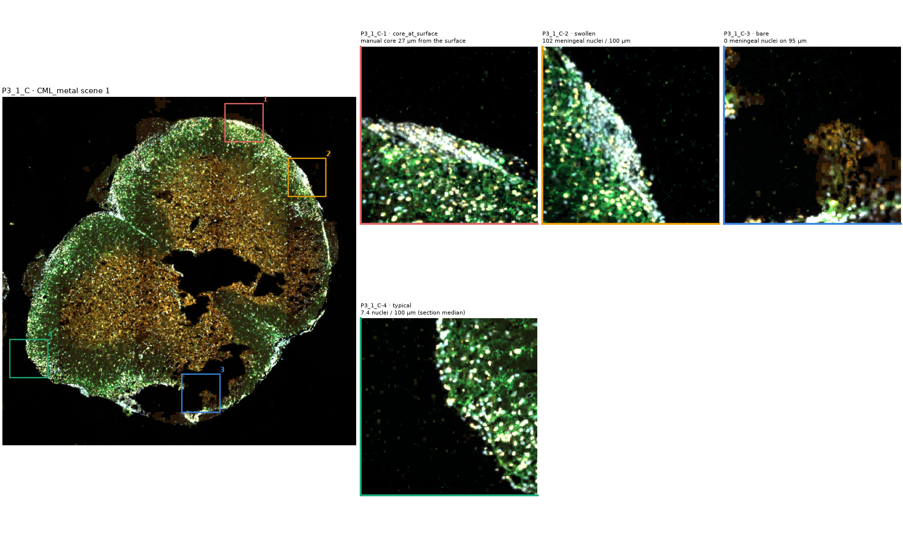
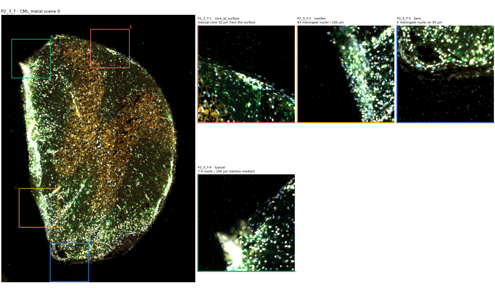
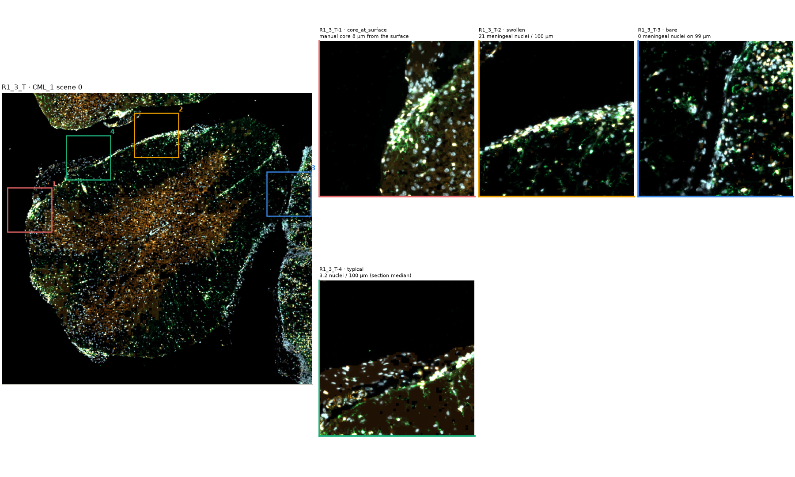
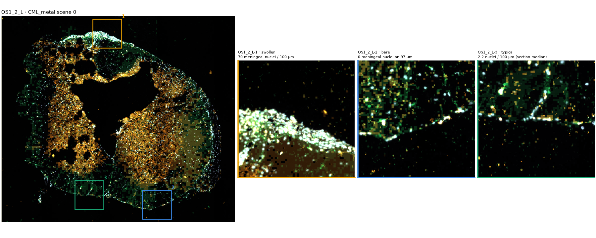
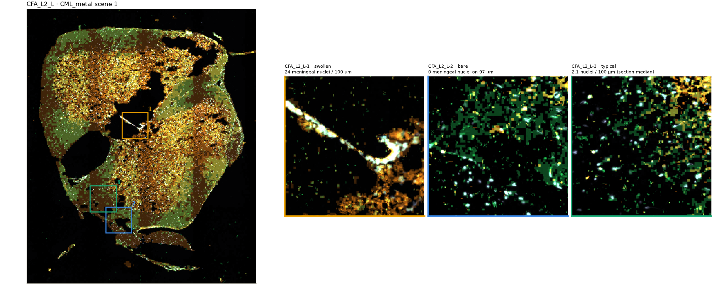
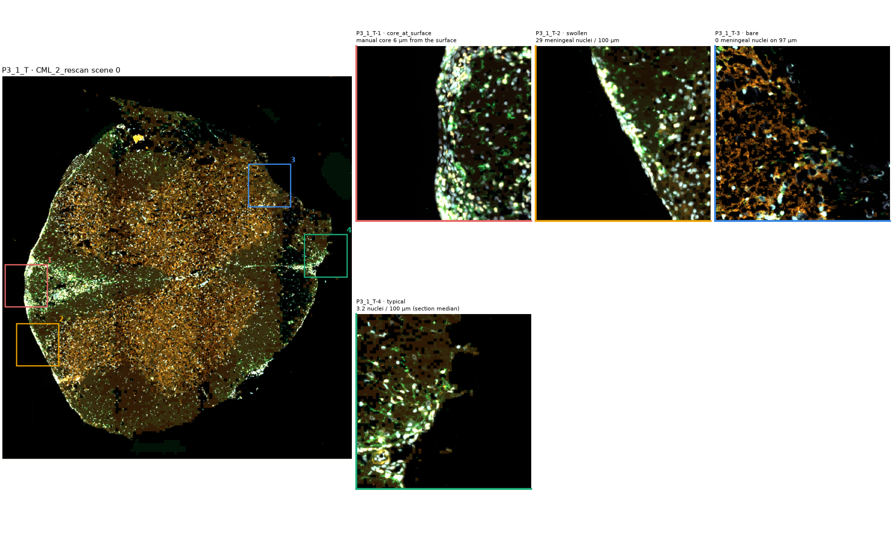
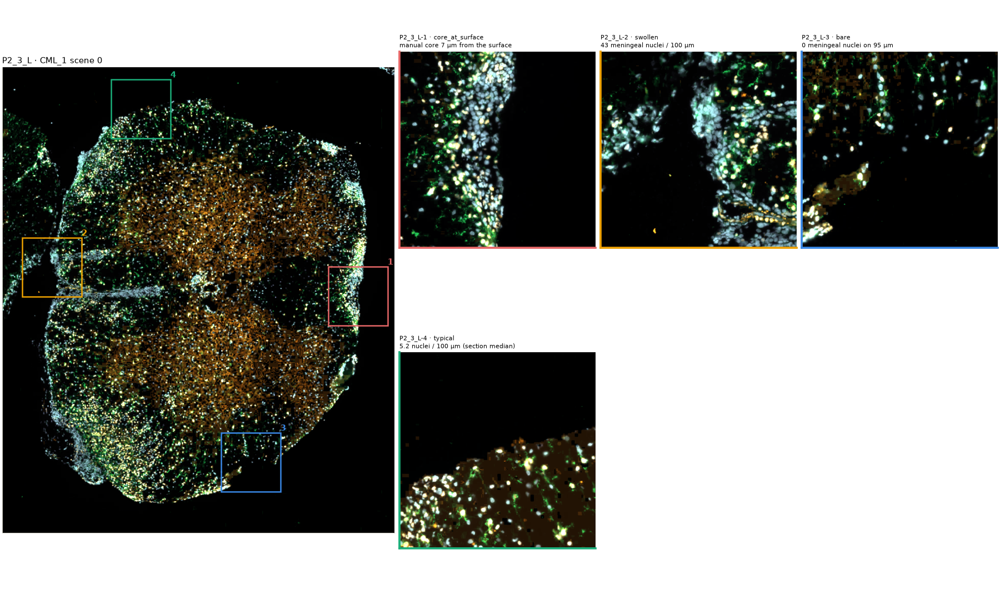

# Meninges annotation targets

Protocol: `docs/meninges_annotation.md`. Boxes per slide: `<slide>_MENINGES_ROI.geojson` (scene px).

8 sections, 31 boxes of 300 µm, every animal covered.

| section | slide | animal | boxes | kinds |
|---|---|---|---|---|
| R1_2_T | 20260917_CML_metal_scene1 | R1_2 | 5 | core_at_surface, swollen, internal, bare, typical |
| P3_1_C | 20260917_CML_metal_scene1 | P3_1 | 4 | core_at_surface, swollen, bare, typical |
| P2_3_T | 20260917_CML_metal_scene0 | P2_3 | 4 | core_at_surface, swollen, bare, typical |
| R1_3_T | 20260917_CML_1 | R1_3 | 4 | core_at_surface, swollen, bare, typical |
| OS1_2_L | 20260917_CML_metal_scene0 | OS1_2 | 3 | swollen, bare, typical |
| CFA_L2_L | 20260917_CML_metal_scene1 | CFA_L2 | 3 | swollen, bare, typical |
| P3_1_T | 20260917_CML_2_rescan | P3_1 | 4 | core_at_surface, swollen, bare, typical |
| P2_3_L | 20260917_CML_1 | P2_3 | 4 | core_at_surface, swollen, bare, typical |

## Previews (raw image; the current boundary is deliberately not shown)

